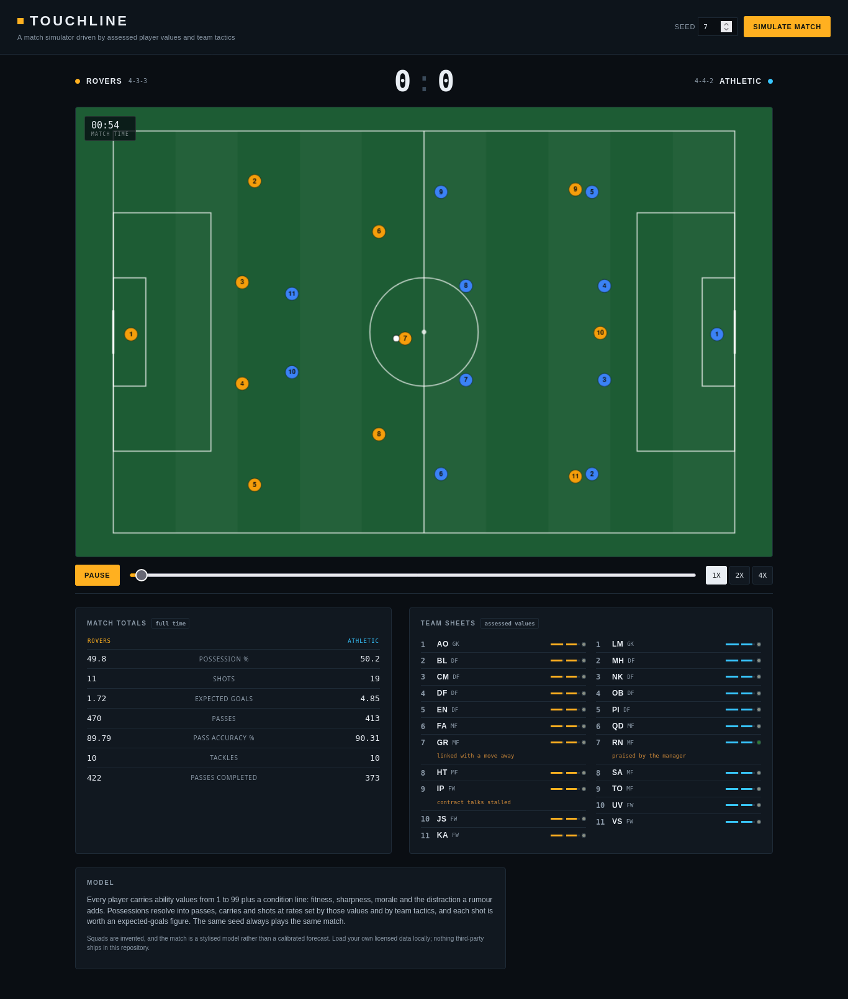

# touchline

A match simulator you can watch. Give it two squads of assessed values and two sets of tactics, and it plays out ninety minutes as a 2D map with a scoreline, shot counts and expected goals that hold together. The same seed always produces the same match.



## What it does

Each player carries ability values from 1 to 99 and a condition line: fitness, sharpness, morale and the distraction a rumour adds. Team tactics set the line height, pressing intensity, width and tempo. The engine turns those numbers into possessions, and each possession into passes, carries and shots.

Because the match is generated rather than recorded, it gives you things a real match cannot: change one player's fitness or one team's pressing height, re-run the same seed, and see what changes. That is the point of the project. It is a sandbox for tactical questions, not a forecast of a real fixture.

## Run it

```bash
git clone https://github.com/TamiloreO/touchline.git
cd touchline
python3 -m http.server 8000
```

Open `http://localhost:8000/demo/`. There is no build step and no dependencies, because the whole thing is plain ES modules and a canvas.

Run the tests with:

```bash
npm test
```

## How the model works

The match runs at five frames a second. Every tick, the side in possession may make a decision, with the rate set by tempo. A decision becomes a shot if the ball is in the final third, otherwise a pass or a carry, with the split set by tempo and by the player's attributes.

A pass succeeds on a probability built from distance, pressure, the passer's passing value and their sharpness and distraction. A failed pass is a turnover. A shot is worth an expected-goals figure from its distance and angle, and converts at a rate scaled by the shooter's finishing and morale. A save restarts play from deep; a goal restarts from the centre.

Three condition values feed the engine directly: fitness scales top speed, sharpness moves pass accuracy, morale moves conversion, and distraction pulls accuracy down. A rumour contributes sentiment times weight, which becomes distraction and morale for that player, so a squad with an unsettled striker plays differently from the same squad without one.

The engine is deliberately a possession chain rather than a physics simulation. A continuous ball model was built first and abandoned: it deadlocked repeatedly, with the ball frozen at one player's feet and no shots for the rest of the match. A discrete model cannot fail that way, and its rates are directly calibratable.

## Calibration

Measured over six seeds, ninety minutes each, with the default squads.

| Measure | Target | Model |
| --- | --- | --- |
| Shots per match | 20 to 30 | 29 |
| Goals per match | 2 to 4 | 3.8 |
| Possession split | 45 to 55 | 53 / 47 |
| Passes per match | 800 to 1000 | 846 |

The model is stylised, not calibrated to a league. It has no offside, fouls, cards or set pieces, and it produces slightly more goals than real football. The numbers above are there so a reader can judge the shape of it rather than take it on trust.

## Data and names

Every squad in this repository is invented, and players are shown by shirt number and initials. Nothing here is real personal data, and no third-party dataset is committed. The plan for real squads is a loader that reads a file you supply locally, with that folder ignored by git, so licensed data never enters the repository.

## Tests

Eleven tests cover determinism, squad integrity, pitch bounds, possession totals, scoreline consistency, expected-goals shape, frame counts and the claim that changing tactics changes the match. They run on Node's built-in test runner with no dependencies.

## Licence

MIT. See [LICENSE](LICENSE).
